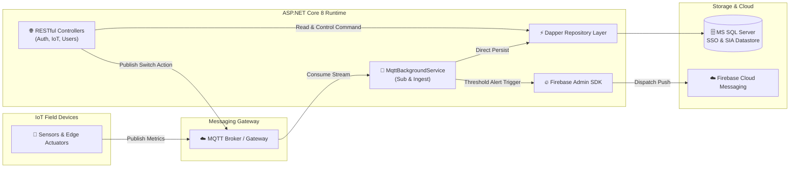

<div align="center">

```
  ██████╗ ███████╗    ██╗ ██████╗ ████████╗
  ██╔══██╗██╔════╝    ██║██╔═══██╗╚══██╔══╝
  ██████╔╝█████╗      ██║██║   ██║   ██║   
  ██╔══██╗██╔══╝      ██║██║   ██║   ██║   
  ██████╔╝███████╗    ██║╚██████╔╝   ██║   
  ╚═════╝ ╚══════╝    ╚═╝ ╚═════╝    ╚═╝   
```

### ⚡ Enterprise IoT Gateway, Telemetry Engine & Microservice Hub ⚡
*High-throughput ASP.NET Core 8 Web API orchestrating MQTT telemetry streaming, MSSQL persistence, and Firebase real-time notifications.*

<br/>

[](https://dotnet.microsoft.com/)
[](https://github.com/dotnet/MQTTnet)
[](https://github.com/DapperLib/Dapper)
[](https://www.microsoft.com/sql-server)
[](LICENSE)

</div>

---

## 🛰️ Architecture Overview

**BE_IOT_KEL67** adalah *backend engine* telemetri dan sistem kendali perangkat IoT kampus/gedung berbasis **ASP.NET Core 8 Web API**. Dirancang untuk arsitektur *high-concurrency*, backend ini bertindak sebagai jembatan antara jaringan *broker hardware* (**MQTT**) dan antarmuka klien mobile/web.

Sistem dilengkapi dengan **MqttBackgroundService** yang berjalan tanpa henti (*worker process*) untuk mengonsumsi data sensor secara asinkron, memvalidasi ambang batas (*threshold alerts*), memicu *push notifications* via **Firebase Cloud Messaging (FCM)**, serta menyimpan riwayat data telemetri ke database relasional dengan **Dapper ORM** untuk performa komputasi maksimal.

---

## 🔮 Structural Diagram & Modules

```
📦 BE_IOT_KEL67
 ├── 📂 Controllers     # RESTful Endpoints (Auth, IotController, Institusi, Upload)
 ├── 📂 DTOs            # Data Transfer Objects & Schema Validation Requests
 ├── 📂 Helpers         # Encryption/Decryption Security, JWT Generators & Custom Handlers
 ├── 📂 Libs            # Enterprise Integration Libraries (PolmanAstraLibrary)
 ├── 📂 Repositories    # Fast Data Access Layer powered by Dapper & SQL Server
 ├── 📂 Services        # Business Logic, LDAP Directory Adapter & MqttBackgroundService
 ├── 📜 Program.cs      # IoC Container, Hosted Services & Middleware Pipeline
 ├── 📜 Dockerfile      # Containerization Specification
 └── 📜 .gitlab-ci.yml  # Automated CI/CD Testing & Deployment Pipeline
```

### 🛠️ Core Capabilities

| Modul | Deskripsi Arsitektur |
| :--- | :--- |
| **⚡ Background MQTT Ingestion** | Background worker thread (`MqttBackgroundService`) yang subscribe ke topic sensor live dan mem-publish perintah saklar/AC. |
| **🔐 Hybrid Authentication** | Dual login authentication: SSO integrasi kampus via **LDAP Directory Service** dan autentikasi lokal terenkripsi dengan **JWT Bearer**. |
| **📊 High-Speed Dapper Queries** | Akses basis data mikro-ORM berkinerja tinggi untuk agregasi metrik daya (*Power Meter*), air (*Water Meter*), dan temperatur. |
| **🔥 Real-Time FCM Alerts** | Pemicu notifikasi otomatis ke device klien ketika anomali atau batas konsumsi daya terlampaui. |
| **🛡️ Permission & RBAC** | Custom `HasPermissionRequirement` untuk otorisasi berjenjang (Superadmin, Teknisi, Civitas Akademika). |
| **📜 Structured Logging** | Implementasi audit logging berkecepatan tinggi menggunakan **Serilog** dengan sink ke MS SQL Server. |

---

## ⚡ Telemetry & Message Pipeline



---

## 🚀 Getting Started

### Prerequisites
* **.NET SDK**: version 8.0 or later
* **Database**: Microsoft SQL Server
* **Broker**: MQTT Broker (EMQX / Mosquitto / HiveMQ)
* **Docker** *(Optional)*

### Setup & Run Locally

1. **Clone repository:**
   ```bash
   git clone https://github.com/alfab3t/BE_IOT_KEL67.git
   cd BE_IOT_KEL67
   ```

2. **Konfigurasi Environment Variables:**
   Pastikan environment variable kunci enkripsi telah terpasang di sistem:
   ```bash
   # Windows PowerShell
   $env:DECRYPT_KEY_JWT="your_jwt_secret_key"
   $env:DECRYPT_KEY_CONNECTION_STRING="your_db_decrypt_key"
   ```

3. **Restore & Build Project:**
   ```bash
   dotnet restore
   dotnet build
   ```

4. **Jalankan API:**
   ```bash
   dotnet run
   ```
   *Buka Swagger UI di: `http://localhost:5000/swagger`*

### 🐳 Run with Docker

```bash
docker build -t be-iot-astratech:latest .
docker run -d -p 8080:8080 --name be-iot-instance be-iot-astratech:latest
```

---

## 💻 Tech Stack & Integrations

* **Language & Runtime:** C# (.NET 8.0 Web API)
* **IoT Protocol:** `MQTTnet (v4.3)`
* **Data Access:** `Dapper (v2.1)`, `Microsoft.Data.SqlClient`
* **Directory & Auth:** `System.DirectoryServices.Protocols` (LDAP), `Microsoft.AspNetCore.Authentication.JwtBearer`
* **Observability:** `Serilog.AspNetCore`, `Serilog.Sinks.MSSqlServer`
* **Cloud Push Service:** `FirebaseAdmin SDK`
* **Documentation:** `Swashbuckle Swagger v9`

---

## 👨‍💻 Engineering Team

Developed with passion by **[Djohan (@alfab3t)](https://github.com/alfab3t)**  
*Smart Campus IoT Infrastructure & Backend Platform • Kelompok 6 & 7*

<div align="center">
  <sub>Part of Advanced Distributed Systems & IoT Cloud Architecture</sub>
</div>
